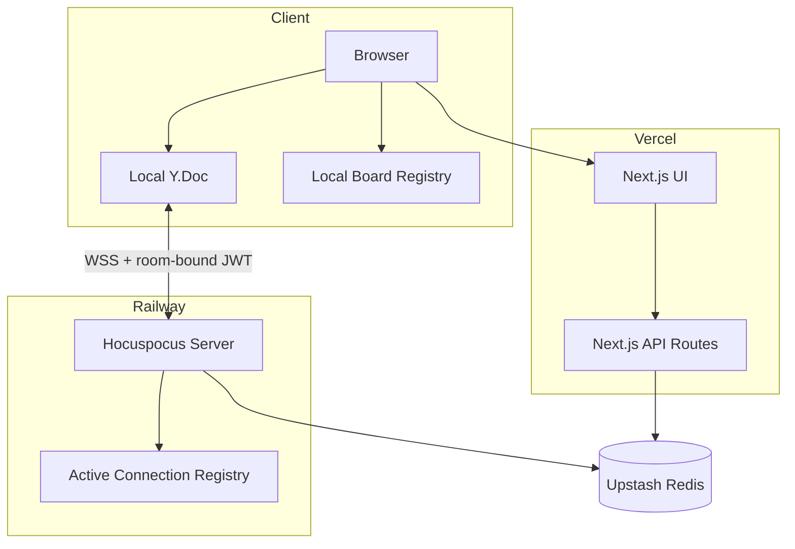
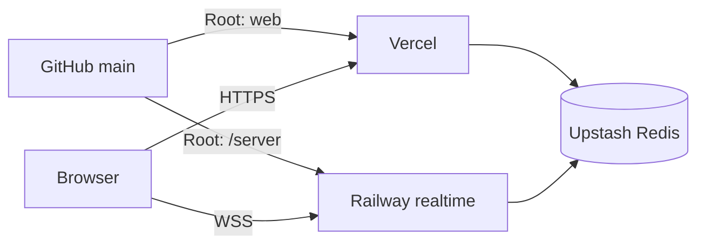

# Production Architecture

This document describes the production architecture, data flows, security boundaries, persistence model, presence model, and scaling constraints of Realtime Whiteboard Collaborator.

## System Overview

The production system has three service boundaries:

1. **Vercel** — Next.js frontend and HTTP APIs
2. **Railway** — Hocuspocus realtime WebSocket service
3. **Upstash Redis** — durable and authoritative shared server-side state



## Session Bootstrap

Anonymous authentication starts through:

```text
POST /api/auth/session
```

The API validates the existing session or creates a UUID-based anonymous user ID.

The signed session is stored as:

```text
wb_session
```

Session properties:

```text
algorithm: HS256
issuer: sayantika-whiteboard
audience: whiteboard-session
lifetime: 30 days
cookie: HttpOnly
sameSite: Lax
secure: production only
path: /
```

The signing secret comes from `WHITEBOARD_AUTH_SECRET` and must contain at least 32 characters.

## Realtime Token Flow

Before joining a collaborative room, the browser requests:

```text
GET /api/auth/realtime-token?roomId=<roomId>
```

The returned token contains:

- authenticated user ID
- exact room ID
- `realtime` token type
- issuer `sayantika-whiteboard`
- audience `whiteboard-realtime`
- five-minute expiry

The token is supplied during Hocuspocus authentication.

## Realtime Authorization

The Railway service verifies:

- token signature
- issuer
- audience
- expiry
- user ID
- exact room ID
- canonical removed-user state

A removed user is rejected even if they still hold an otherwise valid, unexpired room token.

The server checks removal again after connection establishment to close the race between authentication and fully registering the connection.

## Active Connection Registry

Railway tracks active realtime connections as:

```text
room
  -> user
      -> socket
          -> connection
```

Every second, the service evaluates removed-user state for rooms with active connections.

If a user has been removed, tracked sockets for that user are actively closed.

This makes revocation server-driven rather than dependent on the browser voluntarily disconnecting.

## Collaborative Document Lifecycle

Each board is a Yjs document.

The browser creates a local `Y.Doc` and connects to Hocuspocus.

The frontend treats these as distinct states:

```text
WebSocket transport connected
```

and:

```text
Yjs document synchronized
```

Board mutation is allowed only after both are true.

This prevents a reconnecting browser from writing against an incompletely loaded persisted document.

## Durable Yjs Persistence

Redis key:

```text
sayantika:whiteboard:v1:yjs:<roomId>
```

TTL:

```text
7 days
```

### Load path

When a room opens:

1. Railway reads the base64-encoded Yjs state from Redis.
2. The payload is decoded to binary.
3. A new `Y.Doc` is created.
4. The stored update is applied.
5. The populated document is returned to Hocuspocus before client synchronization.

A missing key produces a normal load miss.

Invalid payloads, missing Redis configuration, empty updates, and corrupt state throw instead of silently replacing durable state with an empty document.

### Store path

When Hocuspocus stores a document:

1. `encodeStateAsUpdate` creates the complete Yjs update.
2. the update is base64 encoded
3. Redis stores it with the seven-day TTL

Writes are serialized per room.

This prevents an older asynchronous Redis write from completing after a newer one and overwriting newer persisted state.

### Persistence timing

```text
debounce:          2000 ms
maxDebounce:      10000 ms
unloadImmediately: true
```

These values are explicit in production because they are part of the durability contract.

## Metadata

Board metadata is stored separately:

```text
sayantika:whiteboard:v1:meta:<roomId>
```

Separating metadata from the Yjs document allows lightweight HTTP reads without loading collaborative state.

The active board title is also shared through the collaborative document for realtime participants.

## Host and Removal State

Redis keys:

```text
sayantika:whiteboard:v1:access:<roomId>:host
sayantika:whiteboard:v1:access:<roomId>:removed
```

Host authority is server-side.

Removed-user state is canonical and is checked by the realtime service.

Browser-local role information is never sufficient to grant authority.

## Authoritative Presence

Presence key:

```text
sayantika:whiteboard:v1:presence:<roomId>
```

The realtime service stores presence in a Redis sorted set.

```text
member = authenticated user ID
score  = last-seen epoch milliseconds
```

Timing:

```text
heartbeat interval: 10 seconds
stale threshold:    30 seconds
Redis key TTL:      120 seconds
```

Only the authenticated realtime server writes authoritative presence.

## Presence Write Ordering

Presence writes for one room are serialized.

This matters when a heartbeat and a final disconnect happen close together.

Without ordering:

```text
heartbeat starts
disconnect removal starts
disconnect removal finishes
older heartbeat finishes last
```

The older heartbeat could incorrectly recreate a disconnected user.

Serialized room writes guarantee the later logical operation wins.

## Disconnect Semantics

A browser may have multiple realtime sockets for the same authenticated user.

The server removes the Redis presence member only after the final local socket for that user in the room closes.

This eager removal behavior is one reason the current topology remains single-replica.

## Local Board Registry

The browser maintains:

```text
localStorage: wb_boards
```

The registry stores up to 30 recent boards.

It is used for convenience information such as:

- cached title
- local board ordering
- last-opened timestamp
- last-active timestamp
- cached collaborators
- local role

It is not authoritative for security or durable collaboration state.

## Redis Namespace

All whiteboard production state is namespaced under:

```text
sayantika:whiteboard:v1:
```

Known board keys:

```text
sayantika:whiteboard:v1:board:<roomId>
sayantika:whiteboard:v1:meta:<roomId>
sayantika:whiteboard:v1:yjs:<roomId>
sayantika:whiteboard:v1:presence:<roomId>
sayantika:whiteboard:v1:access:<roomId>:host
sayantika:whiteboard:v1:access:<roomId>:removed
```

The `board` namespace is retained for compatibility with the earlier REST snapshot persistence path.

## Deployment Topology



### Vercel

```text
repository: sinthetaaa/realtime-whiteboard-collaborator
branch:     main
root:       web
```

Production:

```text
https://sayantika-whiteboard.vercel.app
```

### Railway

```text
service:  realtime
branch:   main
root:     /server
region:   Southeast Asia / Singapore
replicas: 1
```

Production WebSocket endpoint:

```text
wss://realtime-production-1abf.up.railway.app
```

Railway provides `PORT`.

The server falls back to `WS_PORT` or port `4000` locally and binds to `0.0.0.0` by default.

## Why One Realtime Replica?

The current persistence implementation stores complete Yjs document state.

Consider two realtime replicas:

```text
Replica A loads state X
Replica B loads state X

A receives update A1
B receives update B1

A persists XA1
B persists XB1
```

Without cross-replica coordination, the later whole-document write can replace state produced by the other replica.

Presence also performs eager disconnect removal based on connections known to the local process.

For these reasons, production deliberately runs one Railway replica.

A future multi-replica architecture would need a persistence and presence model designed for multiple writers, such as:

- append-only Yjs updates
- Redis Streams
- a centralized persistence worker
- room affinity / sticky ownership
- distributed locking with version checks

## Failure Behavior

### Critical Redis persistence unavailable

The collaborative document path fails closed when required persisted state cannot be loaded safely.

### WebSocket disconnect

The provider reconnects.

The UI transitions through transport and synchronization states, and mutations remain disabled until Yjs synchronization completes.

### Presence failure

Presence errors are logged and isolated from collaborative document availability.

### Railway process restart

The new process loads the persisted Yjs document from Redis before the fresh client completes synchronization.

Production testing verified recovery of:

- collaboration state
- shared title
- actual drawable whiteboard stroke

### Participant removal

Active sockets are revoked and future realtime authentication is rejected from canonical Redis removal state.

## Production Acceptance

The deployment was accepted only after these checks passed:

| Check | Result |
| --- | --- |
| Vercel production build | PASS |
| Railway Git-backed deployment | PASS |
| Frontend HTTPS | PASS |
| Realtime service | PASS |
| Two authenticated users | PASS |
| Bidirectional Yjs synchronization | PASS |
| Whiteboard stroke synchronization | PASS |
| Authoritative presence | PASS |
| Redis Yjs store | PASS |
| Railway process restart | PASS |
| Redis Yjs reload | PASS |
| Shared-title recovery | PASS |
| Whiteboard stroke restart durability | PASS |
| Removed-user realtime rejection | PASS |
| Single Singapore replica | PASS |
| Disposable test-data cleanup | PASS |
| Git worktree/origin synchronization | PASS |

## Security Summary

The production design enforces:

- signed HttpOnly anonymous sessions
- 30-day session lifetime
- short-lived five-minute room-bound realtime JWTs
- exact-room verification
- same-origin protection for unsafe HTTP mutations
- server-authoritative host ownership
- server-authoritative removed-user state
- active realtime socket revocation
- no persistent client bearer-token storage
- production secrets outside Git
- Redis key namespacing
